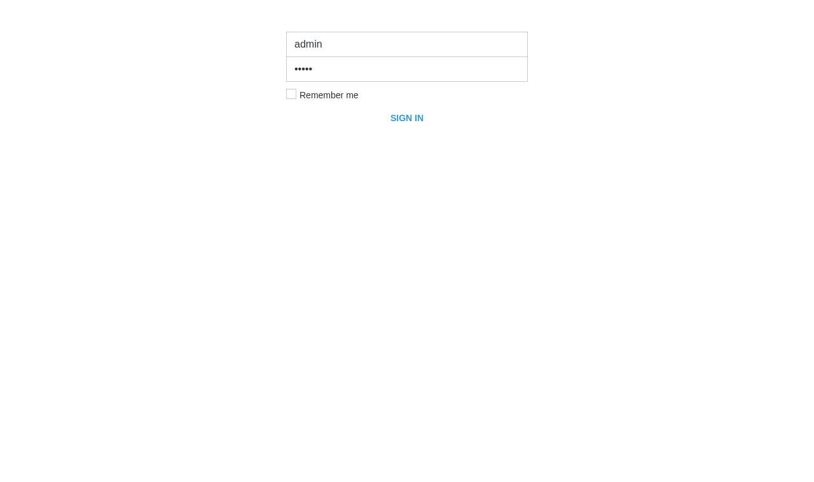
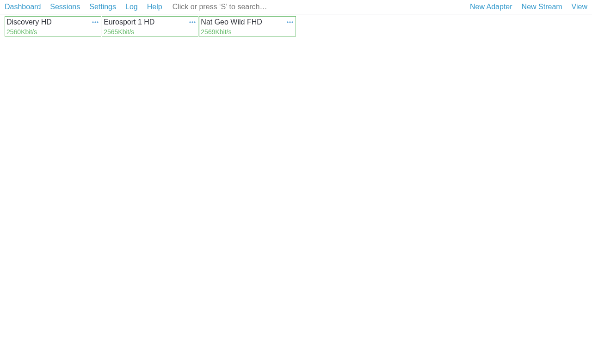

# AstraG — Сервер цифрового ТВ и IPTV-вещания (в стиле Cesbo Astra)

Автономный сервер приёма, буферизации и раздачи цифровых телевизионных потоков (**MPEG-TS / HLS / HTTP / HTTPS / UDP / RTP**) с веб-панелью управления, полностью повторяющий логику установки и управления классического бинарника **Cesbo Astra** (`astrag init`, `astrag remove`, `systemctl start astrag`).

Приём и раздачу HTTP/HTTPS/HLS-каналов выполняет нативное C-ядро **`astrag-core`** (исходник: `astrag_core.c`, в `htop` и списке процессов отображается как **`astrag`**); веб-интерфейс, API и конфигурация работают на Python. Ядро уже встроено внутрь файла `astrag`.

---

## Скриншоты интерфейса

### Окно входа в веб-панель AstraG


### Основное окно управления потоками (Dashboard)


---

## Установка на сервер (Ubuntu 22.04 / 24.04 LTS)

### Вариант 1: Установка одним файлом `astrag` (рекомендуется, как в оригинальной Cesbo Astra)

Скачайте готовый исполняемый файл `astrag` из репозитория `udemika/astron` в `/usr/bin/astrag`, сделайте его исполняемым и зарегистрируйте системный сервис:

```bash
sudo curl -Lo /usr/bin/astrag https://raw.githubusercontent.com/udemika/astron/main/astrag
sudo chmod +x /usr/bin/astrag
sudo astrag init 8000
sudo systemctl start astrag
sudo systemctl enable astrag
```

#### То же самое одной командой (быстрая установка и автозапуск):

```bash
sudo curl -Lo /usr/bin/astrag https://raw.githubusercontent.com/udemika/astron/main/astrag && sudo chmod +x /usr/bin/astrag && sudo astrag init 8000 --start
```

> При выполнении `astrag init` автоматически проверяются и доустанавливаются только штатные системные пакеты Ubuntu (`apt` без `pip` и без `venv`), распаковывается встроенное ядро в `/opt/astrag`, создается конфигурация `/etc/astrag/astrag.conf` и запускается служба `systemd` (в `htop` процесс отображается как **`astrag`**).

---

### Вариант 2: Сборка в нативный ELF-бинарник (опционально)

Если вы хотите дополнительно скомпилировать управляющий сервер на сервере в монолитный ELF-бинарник `/opt/astrag/astrag-bin`:

```bash
sudo curl -Lo /usr/bin/astrag https://raw.githubusercontent.com/udemika/astron/main/astrag
sudo chmod +x /usr/bin/astrag
sudo astrag init 8000 --binary --start
```

---

### Вариант 3: Установка через скрипт `install.sh`

```bash
# Установка на системных APT-пакетах Ubuntu (без pip и без venv):
curl -fsSL https://raw.githubusercontent.com/udemika/astron/main/install.sh | sudo bash -s -- --apt --start --port 8000

# Или сборка в нативный бинарник:
curl -fsSL https://raw.githubusercontent.com/udemika/astron/main/install.sh | sudo bash -s -- --binary --start --port 8000
```

---

## Вход в веб-интерфейс

После запуска откройте в браузере:

```text
http://<IP_ВАШЕГО_СЕРВЕРА>:8000/
```

Данные для входа по умолчанию:
- **Логин**: `admin`
- **Пароль**: `admin`

*(Пароль можно сразу изменить в верхнем меню **Settings → Users** или **Account**).*

---

## Управление сервисом (в стиле Cesbo Astra)

Управление службой осуществляется стандартными командами `systemd`:

```bash
# Запуск сервера
sudo systemctl start astrag

# Остановка сервера
sudo systemctl stop astrag

# Перезапуск сервера
sudo systemctl restart astrag

# Включение автозапуска при загрузке ОС
sudo systemctl enable astrag

# Отключение автозапуска
sudo systemctl disable astrag

# Просмотр статуса и логов
sudo systemctl status astrag
sudo journalctl -u astrag -f
```

### Конфигурационный файл `/etc/astrag/astrag.conf`

Как и в оригинальной Cesbo Astra, **все настройки сервера** (порт `port`, пользователи и пароли `users`, список телеканалов `make_stream`, категории `categories`, кластерные серверы `servers`) хранятся в едином JSON-файле `/etc/astrag/astrag.conf`:

```json
{
  "port": 8000,
  "host": "0.0.0.0",
  "gid": 466560,
  "auth": {
    "enable": true
  },
  "users": {
    "admin": {
      "type": 1,
      "role": "admin",
      "enable": true,
      "password": "admin",
      "created": 1793775989
    }
  },
  "make_stream": []
}
```

Вы можете редактировать порт, пароли и добавлять каналы прямо в `/etc/astrag/astrag.conf` (после правок выполните `sudo systemctl restart astrag`).

### Запуск нового независимого экземпляра AstraG на другом порту (например, `8001`)

Если указать другой порт (например `8001`), автоматически создается **новый независимый экземпляр** со своим файлом `/etc/astrag/astrag8001.conf` и отдельной службой `astrag8001`:

```bash
# Создание и запуск нового экземпляра на порту 8001 (/etc/astrag/astrag8001.conf):
sudo astrag init 8001 --start

# Управление вторым экземпляром:
sudo systemctl status astrag8001
sudo systemctl restart astrag8001

# Удаление только экземпляра 8001:
sudo astrag remove 8001 --purge
```

### Сброс пароля администратора через консоль

```bash
sudo astrag reset-password admin НовыйПароль123
sudo systemctl restart astrag
```

---

## Обновление AstraG

Для обновления достаточно скачать свежий файл `/usr/bin/astrag` из `udemika/astron` и выполнить `astrag init` (все ваши потоки и настройки в `/etc/astrag/astrag.conf` полностью сохраняются):

```bash
sudo curl -Lo /usr/bin/astrag https://raw.githubusercontent.com/udemika/astron/main/astrag && sudo chmod +x /usr/bin/astrag && sudo astrag init 8000 --start && sudo systemctl restart astrag
```

---

## Удаление AstraG

### Стандартное удаление (как в Cesbo Astra)

Остановка сервиса, удаление из автозагрузки и удаление исполняемого файла:

```bash
sudo systemctl stop astrag
sudo systemctl disable astrag
sudo astrag remove
sudo rm -f /usr/bin/astrag
```

### Полное удаление одной командой (включая все настройки и базы `/etc/astrag`, `/var/lib/astrag`, `/opt/astrag`)

```bash
sudo astrag remove --purge
```
